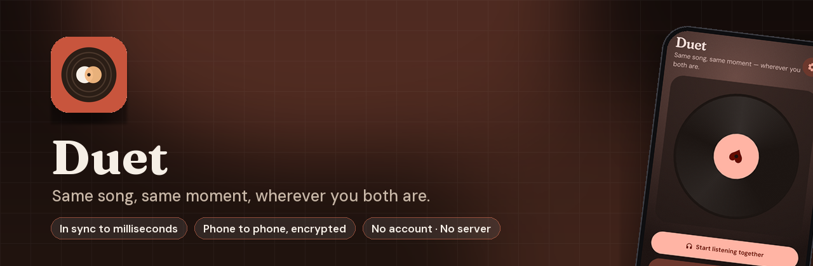
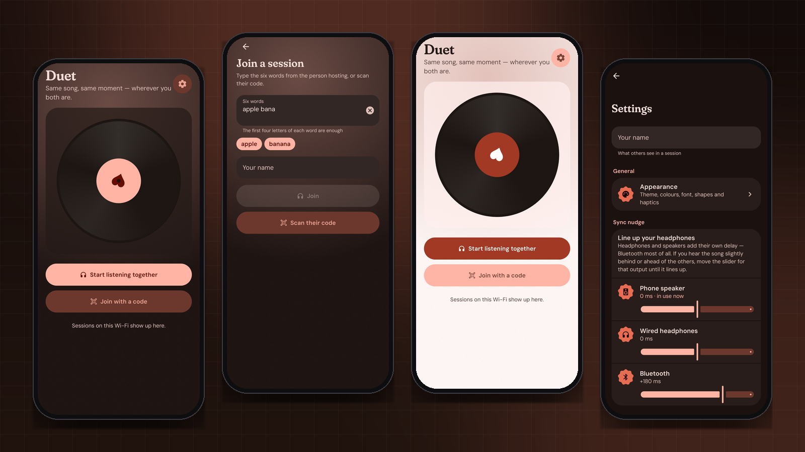
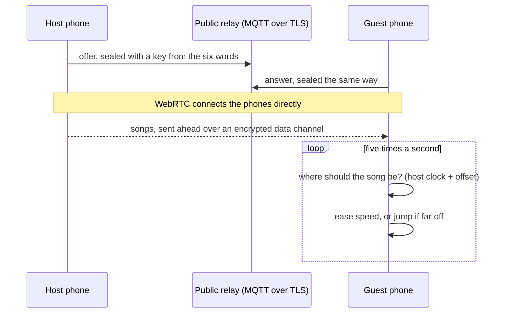

<div align="center">



<br><br>

[](https://developer.android.com)
[](https://kotlinlang.org)
[](https://webrtc.org)
[](LICENSE)
[](https://prempoddar.github.io/Duet/)

**[Website](https://prempoddar.github.io/Duet/)** · **[Download](https://github.com/PremPoddar/Duet/releases)** · **[Privacy](https://prempoddar.github.io/Duet/privacy/)** · **[Report a problem](https://github.com/PremPoddar/Duet/issues)**

</div>

---

**Listen to music together with up to seven other people, on the same couch or in different
cities.** Start a session and Duet gives you six words. Read them out on a call, let someone scan the
code, or send the link. Pick a song from your phone, a YouTube video or a whole playlist, and it plays
on everyone's phone at the same moment. Anyone can pause, skip, seek, vote or add their own songs.

<p align="center"></p>
<p align="center"><sub>Real screens, drawn by the app's own code.</sub></p>

## ✨ Highlights

| | |
|---|---|
| 🎶 **In sync** | Within a few milliseconds, and kept there: each phone eases its own speed instead of jumping. |
| 🌍 **Anywhere** | Phones connect directly over the internet. No account, and no server of ours. |
| 🛋️ **Same room** | On the same Wi-Fi, sessions show up by themselves and work with no internet at all. |
| ▶️ **YouTube** | Play a video or a whole playlist together, kept in step on every phone. |
| 🎧 **Play along** | Line Duet up with a song playing in another music app on each phone. |
| 🗳️ **Shared queue** | Everyone adds songs from their own phone and votes the next one up. |
| 🎤 **Lyrics** | Synced lyrics scroll along for everyone. |
| 👑 **Hand over** | Leaving? Pass the session to someone else and the music carries on. |
| 💬 **Chat &amp; reactions** | Floating emoji over the record, a little chat, and a heartbeat you can send. |
| 🔒 **Lock screen controls** | Keeps playing in the background. |

## 🧭 How it works



### Finding each other

The six words come from the BIP-39 list (66 bits). Stretched with PBKDF2 they give a topic name and
an AES-256 key. Phones exchange WebRTC offers, answers and ICE candidates through HiveMQ's free public
MQTT broker over TLS, sealed with that key, so the broker only ever sees noise under a random topic.
Music never passes through it.

On the same Wi-Fi the host also advertises the session with NSD. A guest who has the code connects to
it directly; a guest who doesn't can tap the session and ask, and on the host's approval receives the
code sealed to a one-off X25519 key. No internet is involved.

> **Limit:** with no relay server of our own (no TURN), roughly one in ten network pairs, mostly on
> strict mobile carriers, can't connect directly. Duet says so and suggests Wi-Fi on one side.

### Playing in sync

The host keeps the shared state: the queue, the current song, and its position at a moment of the
host's clock. Guests estimate the offset to that clock the way NTP does, trusting only pings that
came back about as fast as the fastest, and fitting a line over a few minutes of them so a clock
running slightly fast or slow is followed too. Pings stuck behind song data are ignored.

Five times a second each phone compares where the song *should* be with where its player is. Small
drift is eased out by playing up to 1.5% faster or slower; only a large, lasting gap causes a jump,
aimed ahead by however long a jump has been taking. A per-output **sync nudge** lines up Bluetooth
headphones, which add 150 to 250 ms, and **Sync by ear** can measure it with the microphone.

YouTube's embedded player reports its time late, so Duet watches for the moment the time changes and
keeps the freshest reading; drift there is eased with a 5% speed change where YouTube allows it.

### Songs

The host sends each song to every guest over a WebRTC data channel before it plays, and the next one
while the current one plays. Songs are named by their SHA-256, checked on arrival, limited to 50 MB,
and deleted when the session ends.

## 🔐 Privacy

No account and no server of ours. Music goes directly between the phones, encrypted. The relay that
helps phones find each other only sees sealed, unreadable data. Full policy:
**[prempoddar.github.io/Duet/privacy](https://prempoddar.github.io/Duet/privacy/)**.

## 🛠️ Building and testing

Requires JDK 17 or 21 for Gradle.

```bash
./gradlew assembleDebug
./gradlew testDebugUnitTest
```

Tests cover the session code and key derivation, sealing, same-room pairing, clock estimation
(including clock skew and pings delayed behind transfers), the YouTube position estimate, drift
decisions, every playback command, the protocol, and whole sessions over in-memory links: joining,
songs reaching everyone (and corrupt ones being rejected), guests' songs being forwarded, chat,
reactions, hearts, hand-over, leaving and the eight-person cap. Connecting across networks needs two
real phones.

## 🗂️ Project layout

```
core/     pure Kotlin: session codes, sealing, pairing, clock sync, drift control,
          playback state and commands, protocol, host and guest session logic, lyrics
net/      MQTT relay, local network (NSD + TCP), WebRTC data channels
data/     settings, on-disk song store, music library and import
play/     ExoPlayer sync loop, YouTube player, other apps, media session service
session/  wires a live session together
ui/       Compose screens, the record
```

## 📄 License

[Apache 2.0](LICENSE). Fraunces and DM Sans are used under the SIL Open Font License. The BIP-39 word
list is MIT licensed.
